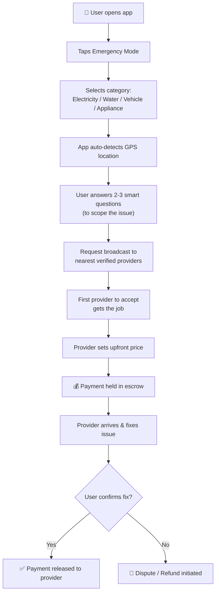
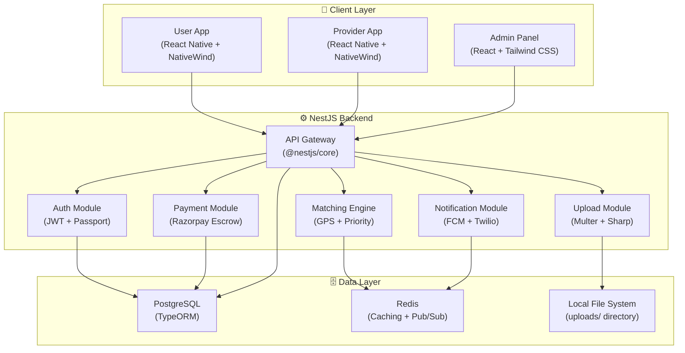

# 🚨 RescueNow — Product Requirements Document (PRD)

**Tagline:** *One-Tap Emergency Help for Home & Vehicle Breakdowns*
**Version:** 1.1
**Date:** February 12, 2026
**Author:** Product Team

---

## 1. Executive Summary

**RescueNow** is a mobile-first emergency response platform that connects users experiencing everyday emergencies (power failures, water leaks, AC breakdowns, vehicle stoppages) with nearby, verified service professionals — in one tap. Unlike traditional service marketplaces, RescueNow is built for **speed and trust**, not browsing. It operates on an escrow-based payment model where providers are paid only after the issue is confirmed resolved.

---

## 2. Problem Statement

| Pain Point | Current Reality |
|---|---|
| **Panic & confusion** | Users scramble during emergencies, searching randomly for help |
| **Overcharging** | No price transparency; providers exploit urgency |
| **Slow response** | Existing platforms aren't optimized for urgency |
| **Low trust** | No verification, no accountability |
| **No resolution guarantee** | Users pay regardless of outcome |

> [!IMPORTANT]
> In emergencies, users want **speed and certainty** — not browsing through service listings.

---

## 3. Solution Overview

A **"911 for daily breakdowns"** — not a services marketplace.

### Core Value Proposition
- **One-tap emergency flow** — no browsing, no typing
- **GPS-based instant matching** — auto-detect location, match nearest provider
- **Escrow payment** — pay only if the issue is resolved
- **Verified providers** — strict onboarding and reliability scoring
- **Speed-first design** — emergency UX optimized for panic situations

---

## 4. Target Users

### 4.1 Demand Side (Consumers)

| Segment | Description |
|---|---|
| **Urban households** | Families dealing with home infrastructure issues (electricity, plumbing, appliances) |
| **Daily commuters & vehicle owners** | People facing vehicle breakdowns on the road |
| **Apartments & gated communities** | Residents of housing societies needing quick service access |
| **Geography** | Tier-1 & Tier-2 cities (India-first launch) |

### 4.2 Supply Side (Service Providers)

| Provider Type | Examples |
|---|---|
| **Electricians** | Wiring, power failures, short circuits |
| **Plumbers** | Water leaks, pipe bursts, drainage |
| **Mechanics** | Vehicle breakdowns, tyre punctures, battery issues |
| **Appliance Technicians** | AC, refrigerator, washing machine repairs |

**Provider Benefits:**
- Verified onboarding (ID + skill tagging)
- Fair pricing control
- Fast payouts
- Steady flow of emergency jobs

---

## 5. User Flow

---

## 6. Feature Requirements

### 6.1 User App (Consumer)

| Feature | Priority | Description |
|---|---|---|
| **Emergency Mode (One-Tap)** | P0 | Large, prominent button to trigger emergency flow |
| **Category Selection** | P0 | Electricity, Water/Plumbing, Vehicle, Appliance |
| **Auto GPS Detection** | P0 | Auto-detect user location; manual override option |
| **Smart Questionnaire** | P0 | 2-3 contextual questions to scope issue (e.g., "Is there sparking?" for electrical) |
| **Photo/Voice Attachment** | P0 | Upload issue photos via Multer + Sharp (compressed, optimized) |
| **Real-time Provider Matching** | P0 | Broadcast to nearest providers; show ETA |
| **Escrow Payment** | P0 | Hold payment until user confirms resolution |
| **Live Tracking** | P1 | Track provider's arrival in real-time on map |
| **In-App Communication** | P1 | Call/chat with assigned provider |
| **Rating & Review** | P1 | Post-service rating for provider |
| **Emergency History** | P2 | Past emergencies, receipts, repeat booking |
| **SOS / Panic Button** | P2 | For situations where user needs immediate escalation |
| **Favorites** | P3 | Save preferred providers for future emergencies |

### 6.2 Provider App

| Feature | Priority | Description |
|---|---|---|
| **Onboarding & Verification** | P0 | ID upload (Multer + Sharp processing), skill tagging, background check |
| **Job Alerts** | P0 | Push notifications for nearby emergency requests |
| **Accept/Reject Flow** | P0 | Quick accept with upfront pricing input |
| **Navigation** | P0 | Turn-by-turn directions to user location |
| **Earnings Dashboard** | P1 | Track completed jobs, earnings, pending payouts |
| **Availability Toggle** | P1 | Go online/offline |
| **Reliability Score** | P1 | Transparent score based on response time, completion rate, ratings |
| **Fast Payouts** | P1 | Quick settlement after confirmed resolution |

### 6.3 Admin Panel

| Feature | Priority | Description |
|---|---|---|
| **Provider Verification Queue** | P0 | Review uploaded ID documents and approve/reject applications |
| **Dispute Resolution** | P0 | Handle payment disputes and refunds |
| **Analytics Dashboard** | P1 | Key metrics: response time, resolution rate, revenue |
| **User & Provider Management** | P1 | Manage accounts, bans, flagged users |
| **Pricing Controls** | P2 | Set category-wise price ranges and surge rules |

---

## 7. Non-Functional Requirements

| Requirement | Target |
|---|---|
| **Response Time** | Provider matched within 60 seconds |
| **App Load Time** | Emergency mode accessible in < 2 seconds |
| **Uptime** | 99.9% availability |
| **Scalability** | Support 100K concurrent users at launch |
| **Security** | End-to-end encrypted communication; PCI-DSS compliant payments |
| **Offline Support** | Cache last-known providers; SMS fallback for low connectivity |
| **Localization** | Hindi + English at launch; expandable to regional languages |
| **Image Optimization** | All uploads processed via Sharp (resize, compress, WebP conversion) |

---

## 8. Monetization Strategy

| Revenue Stream | Description |
|---|---|
| **Emergency Convenience Fee** | Small fee charged to users per emergency request |
| **Commission per Job** | Percentage cut from each successfully resolved job |
| **Provider Subscriptions** | Monthly/annual plans for priority job access and higher visibility |
| **Future: Insurance Partnerships** | Tie-ups with insurance companies for coverage on repairs |
| **Future: Warranty Partnerships** | Extended warranty upsells post-service |

---

## 9. Success Metrics (KPIs)

| Metric | Target (6 months post-launch) |
|---|---|
| **Avg. Response Time** | < 90 seconds to provider match |
| **Resolution Rate** | > 85% first-attempt fix |
| **User Retention** | > 40% monthly active users return |
| **NPS Score** | > 60 |
| **Provider Utilization** | > 5 jobs/provider/day |
| **Escrow Dispute Rate** | < 5% |

---

## 10. Technical Architecture (High-Level)

### 10.1 Tech Stack

| Layer | Technology |
|---|---|
| **Mobile Apps** | React Native (Expo) + NativeWind (Tailwind CSS) |
| **Admin Panel** | React + Tailwind CSS |
| **Backend API** | NestJS (TypeScript) |
| **Database** | PostgreSQL + TypeORM |
| **Caching / Real-time** | Redis + Socket.IO (via `@nestjs/websockets`) |
| **File Uploads** | Multer + Sharp (local `uploads/` directory) |
| **Auth** | JWT (`@nestjs/jwt`) + Passport (`@nestjs/passport`) |
| **Payments** | Razorpay (India-first, escrow flow) |
| **Notifications** | Firebase Cloud Messaging + Twilio SMS |
| **Maps** | Google Maps API / Mapbox |

### 10.2 Architecture Diagram

---

## 11. Risks & Mitigations

| Risk | Mitigation |
|---|---|
| Low initial provider supply | Seed providers with sign-up bonuses; partner with existing unions |
| Fake/fraudulent providers | Strict ID verification + in-person onboarding in Phase 1 |
| Users misusing escrow disputes | Introduce photo/video evidence requirement for disputes |
| Low awareness in early markets | Hyper-local marketing: apartment partnerships, mechanic network tie-ups |
| Payment fraud | PCI-DSS compliance; fraud detection ML models in Phase 2 |
| Local storage scaling | Migrate to cloud storage (S3) in Phase 3 if uploads volume demands it |

---

## 12. Launch Phases

| Phase | Timeline | Scope |
|---|---|---|
| **Phase 1 — MVP** | Month 1-3 | One city, 2 categories (Electrical + Vehicle), core emergency flow |
| **Phase 2 — Expansion** | Month 4-6 | Add Plumbing + Appliances, 3 more cities, live tracking |
| **Phase 3 — Scale** | Month 7-12 | Pan-India Tier-1 cities, insurance partnerships, provider subscriptions |

---

> [!NOTE]
> This PRD is a living document and will be updated as user feedback and market validation data become available.
